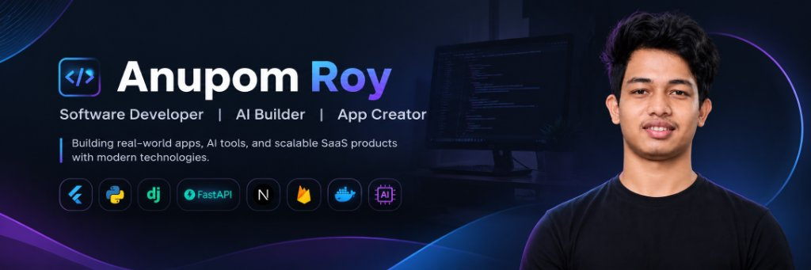

  

    

  

    
  

  

    
    
    
    
  

 

### 💡 Professional Summary & Objective

> **Software Developer specializing in mobile application engineering with Flutter & Dart, native Android (Kotlin), Python backends (FastAPI/Django), privacy-first On-Device AI, browser-based AR (MediaPipe + Three.js), and evaluation-driven RAG systems.**
> Certified in **App Development with Flutter & AI (Ostad)** with demonstrated experience engineering memory-constrained apps with **0 MB background Flutter runtime overhead**, low-latency on-device inference on **2GB–4GB Android hardware**, hardware-backed encryption, real-time cloud architectures, and **measurable LLM quality** (faithfulness / hallucination evaluation with ablation studies).

- 📍 **Location:** Kaliyaganj, West Bengal, India
- 🎯 **Open to:** Entry-level Software Engineering Roles, Full-Stack / Mobile / AI Engineering & High-impact Collaborations.
- 📬 **Get in touch:** [royaa7840@gmail.com](mailto:royaa7840@gmail.com) • [LinkedIn](https://www.linkedin.com/in/anupom-roy-728909401/)

  

---

### 🚀 Featured Engineering Projects

#### 🏃 [ROY SPEED — Body-Tracked AR Endless Runner](https://github.com/anupomroy111/Body-Tracking-AR-Running-Game)

  
  

*`JavaScript (ES Modules)` • `Three.js (WebGL)` • `MediaPipe PoseLandmarker` • `WebAudio API` • `Zero Build Step`*
- **Your Body Is the Controller:** Real-time full-body pose estimation drives gameplay — step sideways = lane change, arms up = jump, squat = slide, T-pose = hoverboard. GPU delegate with automatic CPU fallback, **100% client-side**, no install.
- **Robust Gesture Pipeline:** 2-second height/distance calibration, exponential smoothing, hysteresis lane bands, and per-gesture cooldowns turn noisy landmark streams into reliable real-time game events — with a live gesture coach and graceful touch/keyboard fallback.
- **Complete Game Product:** 4 unlockable runners with gameplay perks, rotating missions, coin-bank progression, 3 difficulty tiers, a fully procedural WebAudio soundtrack (zero audio assets), and a responsive premium dashboard from phone to desktop.

---

#### 🧪 [Custom RAG & Evaluation Pipeline — RAG That Grades Its Own Answers](https://github.com/anupomroy111/custom-rag-evaluation-pipeline)
*`Python` • `Hybrid BM25 + Dense (RRF)` • `LLM Reranking` • `Gemini API` • `LLM-as-Judge`*
- **Self-Evaluating RAG:** Citation-grounded generation with an automated evaluation pipeline measuring **Faithfulness, Hallucination rate, Answer Relevancy, Context Precision/Recall, and Refusal accuracy** — every claim audited against its source passage.
- **Measured Results (12-question golden set):** Faithfulness **1.000** and hallucination **0.000** across all retrieval variants; the ablation study exposes dense-only precision dropping to **0.908** on keyword-heavy queries and RRF fusion recovering it to **1.0**; both unanswerable questions correctly refused — zero fabricated answers.
- **Pure-Python Retrieval Core:** Okapi BM25 + cosine dense search fused with Reciprocal Rank Fusion, listwise LLM re-ranking (relevance grades 0–3), disk-cached embeddings, and one-command 4-variant ablation reports with a per-claim audit trail.

---

#### 🛡️ [ShieldMind AI — Offline AI Notification Firewall & Summarizer](https://github.com/anupomroy111/AI-Notification-Firewall-Context-Summarizer)
*`Flutter (Dart 3)` • `Kotlin` • `Riverpod` • `SQLite (WAL)` • `AES-256-GCM` • `llama.cpp`*
- **Zero-Overhead Architecture:** Engineered an offline Android security app for 2GB–4GB RAM devices with **0 MB background Flutter engine overhead** via native Kotlin background interceptor.
- **Real-Time Threat Classifier:** Built a high-speed Tier-1 security engine (~8 MB RAM, 8–14 ms latency) detecting phishing, OTP harvesting traps, and homograph character spoofing.
- **Privacy & Security:** Implemented hardware-backed **AndroidKeyStore AES-256-GCM** envelope encryption, `Isolate.run()` batch decryption, pure Dart TextRank + `llama.cpp` FFI summarization, and a 60 FPS GPU-optimized UI.

---

#### 🧠 GhostPilot AI — Low-RAM System-Wide Android Screen Copilot
*`Flutter` • `Kotlin` • `Accessibility Service` • `Multi-Process :agent` • `llama.cpp`*
- **Low-Resource Overlay HUD:** Architected a floating copilot operating smoothly on 2GB Android Go hardware (<= 8 MB incremental PSS, <= 50 ms p95 screen text extraction).
- **Play Store Compliant:** Designed strict suggest-only execution (**SafetyGate** confirmation flow) and automated local PII redaction (cards, OTPs, IBANs).
- **Multi-Mode AI Pipeline:** Offline deterministic heuristics, isolated `:agent` native `llama.cpp` inference, and optional BYOK cloud LLM integration.

---

#### 💬 Aora+ — Real-Time Private Android Messenger
*`Flutter` • `Dart` • `Firebase Auth` • `Cloud Firestore`*
- **Zero-Cost Scalable Architecture:** Private real-time messenger built to operate seamlessly on Firebase with Google Sign-In and unique `@username` claims.
- **Optimistic Real-Time Engine:** Implemented optimistic sending (`hasPendingWrites`), message editing, soft deletion, typing indicators, live presence, and lightweight split-ABI APKs (**22.9 MB** arm64-v8a).

---

#### 🔧 AI Mobile Technician & Voice Assistant
*`Kotlin` • `Jetpack Compose` • `Material 3` • `Room` • `SpeechRecognizer` • `Gemini API`*
- **Diagnostic Agent:** Engineered a bounded troubleshooting workflow (*observe → diagnose → consent → verify*) running live DNS/HTTPS probes with strict tool allowlists.
- **Multilingual Voice Engine:** Built multilingual speech dictation supporting **Bengali, Hindi, English, and Banglish** paired with a Gemini structured-output proxy.

---

#### 📚 AI-Powered Quiz & Learning Platform
*`Flutter` • `Go (Chi)` • `PostgreSQL (pgvector)` • `FastAPI` • `NATS JetStream` • `MinIO`*
- **Modular Monolith & Microservices:** Material 3 Flutter client integrated with high-performance Go backend and Python background workers for isolated document ingestion and vector semantic search (`pgvector`).

---

### 🎯 Technical Skills & Arsenal

#### 💻 Programming Languages

  
  
  
  
  
  
  

#### 📱 Mobile Engineering

  
  
  
  
  
  

#### 🕶️ AR, Graphics & Game Engineering

  
  
  
  
  

#### 🤖 AI Engineering — On-Device, LLM & RAG

  
  
  
  
  
  
  
  

#### ⚙️ Backend, Web & Message Brokers

  
  
  
  
  
  
  

#### 🗄️ Databases & Storage

  
  
  
  
  

#### 🛠️ Developer Tools & DevOps

  
  
  
  
  
  

---

### 🎓 Certifications & Training

- 🏆 **App Development with Flutter & AI** — *Ostad* (Intensive hands-on training covering Flutter UI architecture, reactive state management [Riverpod, Provider], Firebase, REST APIs, and On-Device/Cloud AI workflows).
- 🏫 **Secondary Education (10th / Madhyamik)** — *Kaliyaganj Parbati Sundari High School (WBBSE)*

---

### 📊 GitHub Activity & Analytics

  
  

 

  

 

  

 

  

---

### 🌐 Connect With Me

  
  
  

  ⭐️ Built with precision, code &amp; passion by <a href="https://github.com/anupomroy111">Anupom Roy</a>

