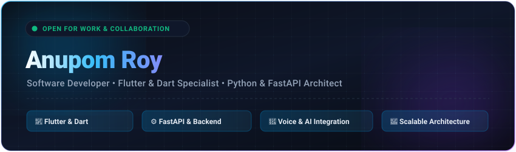

  

    

  

    
  

  

    
    
    
    
  

 

### 👨‍💻 About Me

> **Full-Stack & Mobile Developer** passionate about turning ambitious ideas into scalable, production-ready software. Focused on building smooth mobile apps with **Flutter** and high-performance backends with **Python & FastAPI**.

- 🔭 **Current Focus:** Engineering cross-platform mobile apps, AI-driven APIs, and real-time microservices.
- 📱 **Mobile Core:** Expert in **Flutter & Dart** with clean architecture, Provider, and reactive state management.
- ⚡ **Backend & APIs:** Designing robust RESTful services and asynchronous workers using **FastAPI, Django & Python**.
- 🤖 **AI & Innovations:** Implementing context-aware summarizers, voice processing, and intelligent assistants.
- 💬 **Let's Talk About:** Flutter development, Clean Code, Backend Architecture, Open-Source & New Tech.
- 💼 **Connect with Me:** Find me on [LinkedIn](https://www.linkedin.com/in/anupom-roy-728909401/) or reach out via [Email](mailto:254368140+anupomroy111@users.noreply.github.com).

---

### 🛠️ Tech Stack & Arsenal

#### 💻 Programming Languages

  
  
  
  
  
  
  
  

#### 📱 Frameworks & Web Technologies

  
  
  
  
  
  

#### 🗄️ Databases & Cloud

  
  
  
  

#### ⚙️ Developer Tools & DevOps

  
  
  
  
  
  

---

### 🚀 Highlighted Projects

| Project | Description | Tech Stack |
| :--- | :--- | :--- |
| 🎙️ **[anupom-chat-ai-api-VOICE](https://github.com/anupomroy111/anupom-chat-ai-api-VOICE)** | Advanced FastAPI backend for mobile apps with real-time voice processing and conversational AI. | `Python` `FastAPI` `Voice AI` |
| 🛡️ **[AI-Notification-Firewall](https://github.com/anupomroy111/AI-Notification-Firewall-Context-Summarizer)** | Context-aware AI engine summarizing high-volume notifications to prevent fatigue. | `Python` `NLP` `AI` |
| 🛍️ **[ecommerce_app](https://github.com/anupomroy111/ecommerce_app)** | Modern, fully featured mobile e-commerce client with dynamic cart, checkout & slick UI. | `Flutter` `Dart` `REST API` |
| ⚽ **[live-score-app-anupom](https://github.com/anupomroy111/live-score-app-anupom)** | High-frequency sports updates and live match tracker application. | `Flutter` `Dart` |
| 📋 **[Task-Manager-Provider](https://github.com/anupomroy111/Task-Manager-Ostad-project-provider)** | Production-grade task organizer implementing Provider architectural pattern. | `Flutter` `Dart` `Provider` |

---

### 📊 GitHub Activity & Analytics

  
  

 

  

---

### 🌐 Connect With Me

  
  
  

  ⭐️ Crafted with precision &amp; code by <a href="https://github.com/anupomroy111">Anupom Roy</a>

